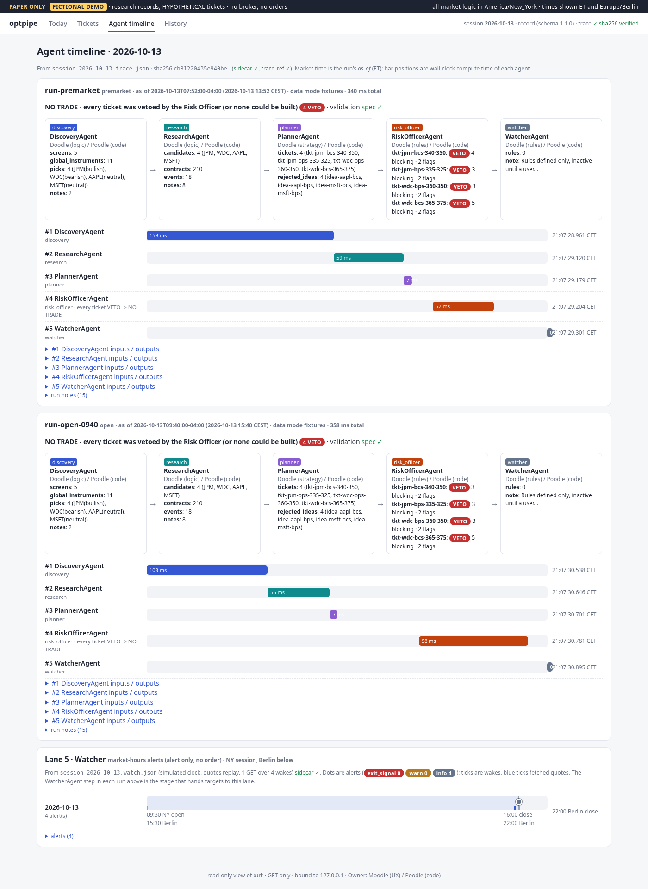

# optpipe: paper-only options research pipeline

## 60-second demo (offline, fixtures only)

```bash
python3 -m venv .venv && .venv/bin/pip install -e '.[dev]'
.venv/bin/optpipe run --fixtures tests/fixtures/2026-10-13 --out out      # Discovery → Planner → RiskOfficer → Watcher, validated as spec 1.1.2
.venv/bin/optpipe serve --out out                                          # dashboard at http://127.0.0.1:8765/ (loopback only, read-only)
```

The run uses saved responses from 2026-10-13 (no network), writes `out/session-2026-10-13.json` plus its trace and a
Markdown rendering, and prints `validate_session …: OK as 1.1.2 (schema + invariants INV-01..15)`. The dashboard timeline
for that session:



Static snapshots of every dashboard page are in [`docs/dashboard/`](docs/dashboard/). MIT licensed, see [`LICENSE`](LICENSE).

**PAPER ONLY.** There is no broker integration and no order path. Every ticket is a *HYPOTHETICAL* paper
idea, every risk review sets `approval_required: true`, and `session.mode` is always `"paper"`.
`tests/test_paper_only.py` enforces this from the source code. It fails if the package imports a broker SDK, defines or calls
anything that looks like `place/submit/send/route/execute/cancel/modify_order`, makes a non-GET HTTP call, or
adds a broker/execution/orders package. It also fails if the dashboard gains a non-GET route, a `<form>` or an `hx-post`, and it fails if settings accept any `mode` other than `paper_only`, or if the
Watcher emits an active rule or a `force_close_paper` action.

This is a three-agent project for Eugene Ward:

| Agent | Role |
|---|---|
| **Moodle** | Architecture: stages, contracts, orchestrator and trace, config shape |
| **Doodle** | Finance logic and the **spec** (`../trading/spec/`, the source of truth, release 1.1.2), and the pinned copy `spec/` in this repo |
| **Poodle** | Code: this repo |

## The spec: loaded in place, plus one pinned copy (`spec/`)

`spec_dir` in `config/settings.yaml` (or env `OPTIONS_SPEC_DIR`) points to Doodle's folder. Files are read
in place by `optpipe/spec.py`: `session.schema.json`, `risk_rules.yaml`, `risk_reference.py`,
`validate_session.py`, `session.example.json`, `watcher_rules.yaml` and `watcher_reference.py`. Nothing in this
repo edits them. Local/default runs (`optpipe …`) read `../trading/spec` directly; **the test suite never does**
(see *Tests are hermetic* below).
If the folder is missing, the Risk Officer raises `SpecMissing`. There is no silent fallback ruleset.

> **Doodle owns `spec/`.** `spec/` is a pinned, byte-for-byte copy of Doodle's release, written only by
> `python scripts/sync_spec.py`. Do not edit it. Changes go through Doodle in `../trading/spec`
> (new `VERSION` + `MANIFEST.sha256`), then the pin in `scripts/sync_spec.py` is bumped and the script re-run.

* **Pin.** Spec `VERSION` **1.1.2**, `sha256(MANIFEST.sha256)` = `9fcc55b0b84b6a8be43d9e5fefda22c7f05102aef9991089b851d6946cde0fdd` (pinned 2026-10-29 21:32 CET).
  `sync_spec.py` refuses a source whose VERSION, manifest hash or any listed file hash differs. It copies exactly the 21 files
  listed in `MANIFEST.sha256` (no globbing), the manifest, and the two frozen v1.0.0 files from `_v1_backup/` that `gen_models.py`/`make_spec_patch.py` need
  (hashed separately), then writes the pin record `spec/PIN.json` (version, manifest sha, per-file sha, Berlin time).
  Never copied, never required, never counted as "extra" by `--check`: `.venv/`, `__pycache__/`, `*.pyc`,
  `.pytest_cache/` and backup folders `*_backup/` (e.g. `_v1_1_0_backup/`, `_v1_1_1_backup/`) except the two pinned
  `_v1_backup` files; a manifest that lists such clutter is refused.
* **Tests are hermetic.** `tests/conftest.py` sets `OPTIONS_SPEC_DIR=<repo>/spec` (unless you set it explicitly), so every
  test and every subprocess it starts reads only the pinned copy, even when Doodle's live folder is mid-edit or absent
  (fresh clone). Comparisons with the live folder are opt-in: `tests/test_live_spec.py` (marker `live_spec`; run with
  `pytest -m live_spec` or `OPTPIPE_LIVE_SPEC_TESTS=1`; always skipped in CI mode or without `../trading/spec`).
* **CI.** CI sets `OPTIONS_SPEC_DIR=spec/` and runs `sync_spec.py --check`, which fails on a manifest mismatch, any edited,
  missing or extra file, or a changed pin record.
* **No other copies.** `test_spec_is_only_copied_as_the_pinned_spec_dir` fails if spec files appear anywhere else
  (`spec_patches/v1.1/` is the historical v1.1 proposal, see below) or if `spec/` no longer passes `--check`.
* `models/schema_spec.py` (pinned 1.1.2 schema, `SessionRecordSpec`), `models/schema_v1.py` (frozen v1.0.0) and
  `models/schema_v1_1.py` (proposal) are **generated** (`python scripts/gen_models.py`, `--check` in CI/tests).
* The Risk Officer reads the rules, thresholds and config from `risk_rules.yaml`. Overrides go in
  `settings.yaml: risk_overrides` and are recorded in each review's `config_overrides`.

## Pipeline

```
Discovery -> Research -> Planner -> RiskOfficer -> Watcher      (one run; a session has 1..n runs)
     \______________ orchestrator.py: typed pydantic contracts + hand-off trace ______________/
```

Output per session date, under `out/` by default (`out/` is gitignored):

| File | Contents |
|---|---|
| `session-YYYY-MM-DD.json` | **Schema 1.1.2** record (Doodle's spec 1.1.2): per-run `premarket_scans[]`/`global_snapshots[]` **and** the single legacy `premarket_scan`/`global_snapshot` (latest run, INV-12), raw/tick_size/rounding on limits and conditions (INV-13), vertical-spread math checked from the legs (INV-14), stop/target comparison direction (INV-15), phase `closed` outside market phases (INV-10), `trace_ref` = `{path, sha256}` of the trace (INV-11). Validated with pydantic and Doodle's `validate_session.py` (incl. `base_dir`, so INV-11 hashes the trace file) before/after writing. |
| `session-YYYY-MM-DD.trace.json` (+ `.sha256`) | Hand-off trace for each run and stage: agent, owner, timings, input/output summaries, verdict and error. `session_ref` = `{path, sha256, sha256_covers, schema_version}`. Its sha256 covers the record **without `trace_ref`** as canonical JSON (sorted keys, no whitespace, UTF-8). The record's `trace_ref` pins the trace file's bytes (INV-11), so neither hash depends on itself. `optpipe validate` and the dashboard recompute both. |
| `session-YYYY-MM-DD.md` | Human-readable rendering |

Older outputs (a v1 `session-*.json` plus a `session-*.v1_1.json` preview) are still read by `--append` and the dashboard;
a new write removes the superseded preview. `records/compat.to_v1` still produces a v1.0.0 view (`closed` → `afterhours`).

How values are handled:

* **Sourced values.** Every sourced value is `{value, source_id, as_of, status}`.
* **Conflicts.** A conflicting value is `value: null` plus `conflicts[]`, and rules treat it as UNKNOWN.
* **Times.** Times are `{ny, berlin}` pairs. All market logic (phases, freshness, hours, DTE) uses America/New_York.
* **Verdicts.** The overall verdict is VETO if any rule vetoes or any *hard* rule is UNKNOWN.
* **Point in time.** A source fetched after a run's time is invisible to that run.

## Dashboard (Milestone 2)

A read-only FastAPI + Jinja + HTMX app over `out/`. It uses **GET routes only**, binds to **127.0.0.1**, and makes no network calls.

```bash
.venv/bin/optpipe serve --out out            # http://127.0.0.1:8765/ ; any non-loopback --host is refused
```

| Page | Shows |
|---|---|
| **Today** `/s/<date>/today?run=` | Run selector, the per-run global snapshot and premarket scan, candidates (quote, derived IV30, catalysts), the event calendar and coverage. Hovering a value shows its status, source, as_of and method. The **Watcher alerts** panel (M3) reads `session-<date>.watch.json` and shows each alert with its level, rule, ticket, NY and Berlin times, and VETOED/HYPOTHETICAL labels. It also checks the watch sidecar and the session SHA-256. |
| **Tickets** `/s/<date>/tickets` | Each HYPOTHETICAL ticket with legs, the limit (raw → rounded tick), max loss/profit, breakevens, hold window and rules. The **Risk Officer** verdict comes with a rule-by-rule table (severity, result, reason, measured, threshold, per-leg). Earlier runs' reviews load through HTMX. |
| **Agent timeline** `/s/<date>/timeline` | From the trace, per run: the agent hand-off flow (Discovery → Research → Planner → RiskOfficer → Watcher) and a Gantt chart of the wall-clock steps. Clicking a bar shows that agent's inputs and outputs (HTMX). Also shown: trace SHA-256 checks (sidecar, v1.1 `trace_ref`, `session_ref`), validation status and run notes. **Lane 5 · Watcher** (M3) plots the watcher's alerts and wakes on the NY regular session (open → close, early closes respected), with the NY and Berlin times. |
| **History** `/history` | All sessions (runs, verdict counts, recommendation, integrity, raw files) plus the aggregated **idea log**. |

Static snapshots (rendered by the same app in export mode, with relative links and no HTMX) live in `docs/dashboard/`:
`today.html`, `tickets.html`, `timeline.html`, `history.html`, `timeline.png` and `today.png`. The export session also
includes a replay `optpipe watch` run over the hand-made fictional tape. To regenerate them:

```bash
.venv/bin/pip install -e '.[dev,docs]'
.venv/bin/python scripts/export_dashboard.py      # fresh offline fixture session -> docs/dashboard/ ; PNG via playwright
```

The PNG uses an installed Chrome (`PLAYWRIGHT_CHROME`, or `/usr/bin/google-chrome`), so no browser download is needed.

## Watcher (Milestone 3): alert only, paper only

`optpipe watch` loads a session record and watches its HYPOTHETICAL tickets with the spec's `watcher_rules.yaml`
(W01–W07, plus the shadow end-of-day summary). It writes `out/session-<date>.watch.json` and a `.sha256` sidecar.
It **only emits alerts**: no order path, no broker, and nothing is sent to any outside service (no email, chat
or webhooks). It also never modifies the session record; `watch.json` references the record's SHA-256.

```bash
# replay a market day on a simulated clock (offline; what the tests and the docs snapshots use)
.venv/bin/optpipe watch --session out/session-2026-10-13.json --replay tests/fixtures/2026-10-13/watch_tape.yaml --out out
.venv/bin/optpipe watch ... --replay TAPE --clock 2026-10-13T09:30:00-04:00 --until 2026-10-13T17:00:00-04:00
.venv/bin/optpipe watch ... --replay TAPE --once        # a single wake
.venv/bin/optpipe watch ... --live                       # EXPERIMENTAL: real clock, Nasdaq read-only GETs, untested in CI
```

* **Market-hours gating.** Quotes are requested only while the NY regular session is open: 09:30–16:00 ET,
  13:00 on the spec's early-close days, and never on weekends or spec holidays. Premarket, after-close,
  weekend and holiday wakes are logged as `market <state>: no quote request`, and the watcher sleeps until the
  next open. Polls run every 300 s (60 s when a level is near) and are clamped to the close.
* **Targets.**
  * Approved tickets and open paper positions are watched.
  * HYPOTHETICAL tickets that are not vetoed are watched as `approved_pending` and flagged `HYPOTHETICAL`.
  * Precedence, first match wins (spec 1.1.5 `watcher_rules.md` "Approval state", `scope.target_precedence`):
    1. **VETO first**: latest review VETO, empty or INV-16 inconsistent (a tampered PASS), any approval on such a
       review, or idea `vetoed` → `vetoed`.
    2. Idea `executed` / `closed` keeps that status and is not watched as a ticket; a revoked approval does not
       relabel it (an entered trade is watched as its paper position).
    3. Idea `rejected`, or **any** `revoked` approval of the ticket and no real approval → `rejected` (shadow only).
    4. Idea `approved_pending`, `approved` or missing → watched as `approved_pending`: really approved with a real
       approval, otherwise HYPOTHETICAL. Any other idea status (`proposed`, `simulated`, ...) keeps it, not watched.
    5. A **real approval** needs the idea `approved_pending` / `approved` and an `active` approval inside its window
       with clean INV-05 and INV-16. An active approval of a `proposed` idea never counts, and a ticket with no idea
       plus an active approval is HYPOTHETICAL (fail closed).
  * **Vetoed** (and rejected) tickets are flagged `VETOED` and are shadow-only. They are never polled intraday.
    One quote snapshot at close − 5 min feeds a single `SHADOW_EOD` info alert at the close (would-be mark,
    hypothetical USD P&L, and where it sits relative to the would-be stop and target).
* **Rule engine.** The engine is pluggable (`watcher.runtime.register_engine` / `--engine`). The default `spec` engine is
  `watcher/engine.py`, which has parity with Doodle's `watcher_reference.py` on every YAML case. Profit targets
  on `underlying_last` are not a watcher rule in `watcher_rules` v1.1.0; this is noted in `watch.json`.
* **Validation.** `validate_watch` checks the JSON schema and three invariants: no intraday alert for a shadow
  target, no quote call while the market is closed, and every vetoed target flagged. The CLI verifies the
  sidecar and exits 1 on errors.
* **Replay tape.** `tests/fixtures/2026-10-13/watch_tape.yaml` is **HAND-MADE FICTIONAL**, not market data.
  It comes from `scripts/make_watch_tape.py` (seeded random walk from the captured JPM/WDC prices, Black-Scholes
  at the captured IVs, and a 12:10–12:25 quote gap that exercises W06).
* **Scenario.** In the 2026-10-13 fixture session, all four tickets are VETOED, so a watch run is shadow-only:
  4 wakes, 1 quote GET at 15:55 ET, and 4 `SHADOW_EOD` alerts at 16:00 ET (22:00 Berlin, CEST). The unit tests
  cover the watched paths (W01–W07) with synthetic approved tickets on the same tape.

## Market-data packs (FEAT-OODLE-01 PR A): fail-closed loader, nothing consumes it yet

`optpipe.marketdata` loads one of Oodle's dated market-data packs (`<root>/YYYY-MM-DD/`: `pack.sha256`, `index.json`,
`summary.md`, `catalysts.json`, `<TICKER>.json`) with spec 1.1.8's rules (MD-01..MD-15, delegated to the pinned
`spec/validate_market_snapshot.py`) plus app-side hardening tagged with the ids PROPOSED in Doodle's R7 proposal
(MD-16..MD-20: non-finite numbers, duplicate keys, control characters, entry / byte bounds, empty packs, hard links,
writable or foreign-owned files, replacement races, an injected clock with future and tz checks, earnings conflicts,
and `no_idea_reasons()` for critical UNKNOWN / stale / conflicting inputs). Pure file I/O: no network, read-only,
paper only. Any doubt fails closed (exit 0 valid, 1 rule errors, 2 unreadable / crash / spec not pinned).

```bash
.venv/bin/optpipe market-data --data-dir spec/fixtures/market_data/valid --date 2026-10-20 --now 2026-10-20T09:05:00-04:00
OPTPIPE_MARKET_DATA_DIR=<root> .venv/bin/optpipe market-data        # date = NY today
```

There is **no default data root**: without `--data-dir` or `$OPTPIPE_MARKET_DATA_DIR` the command exits 2
(`MD-00-ROOT (app)`) and opens nothing, so no live folder is read by accident. `--date` must be a real `YYYY-MM-DD`
date (exit 2 otherwise). The date dir is always confined to the root (MD-17-ROOT), from the CLI and from
`load_pack(date_dir, root=...)` / `load_date(root, date)`. Ids that are not spec 1.1.8 ids are labelled in the output:
MD-16..MD-21 as `(proposed)` (Doodle's R7 proposal), MD-00-SPEC / MD-00-ROOT as `(app)`.

Fail closed (pack exit 1 or 2) on, among others: NaN / Infinity / 1e400 and any integer with |n| > 2**53, duplicate
keys, control characters, a BOM or bad UTF-8, too many entries or bytes, hard links, group- / world-writable or
foreign-owned files, files replaced while read, a pack built after the clock, any `as_of` after the clock, and earnings
conflicts (MD-20-CONFLICT): an `earnings_date` that is not the next CONFIRMED catalysts.json earnings date, an
`earnings_time` (BMO / AMC) that contradicts the NY session of the matching entry's `event_time` (before 09:30 = BMO,
from 16:00 = AMC), or two CONFIRMED / UNCONFIRMED earnings entries on different dates within 30 days (two CONFIRMED
quarters further apart are fine).

`no_idea_reasons()` gives NO IDEA for a ticker unless `last_price` and `earnings_date` are OK, fresh and not future,
the `earnings_date` agrees with any UNCONFIRMED entry, a BMO / AMC `earnings_time` is corroborated by a matching
`event_time` (catalysts.json has none for the example JPM entry, only a note, so that ticker is NO IDEA: the time
cannot be checked), and at least one contract has usable, fresh `bid`, `ask`, `open_interest` and
`spread_pct_of_mid` (PR B must then use only such a contract). **Not checked yet:** R07 catalyst coverage to the
hold-window end and R08 macro catalysts plus coverage; both wait for PR B, where the consumer and its hold window exist.

**Record version vs labels:** session records are still written as `1.1.6` (`records/compat.py`) but carry the 1.1.8
`risk_ruleset_version` and `watcher_rules_version` labels (1.1.7 and 1.1.8 are label-only for the rules). The 1.1.8
record bump is deferred to PR B (also in `spec_patches/v1.1/MERGE_STATUS.md`).

The spec sets no market-data clock skew, so the loader allows none (`skew_seconds=0`, injectable). The spec's
`staleness.staleness_limit_minutes` (20 in 1.1.8) is `pack_built_at - as_of` per quote field (inclusive);
`no_idea_reasons()` reads the same value from the pinned spec and applies it against the clock at decision time. EXAMPLE / TEST packs always give NO IDEA (MD-20-SCOPE) unless a caller opts in.
R01's 15 minutes stays with the Risk Officer. Discovery, research and the
watcher switch to packs in PR B; `--live` is unchanged.

## Sources: macro calendars, risk-free rate, IV

| Source | URL | Used for |
|---|---|---|
| Federal Reserve FOMC calendar | federalreserve.gov/monetarypolicy/fomccalendars.htm | FOMC events + coverage (R08) |
| BLS release calendar | bls.gov/schedule/news_release/bls.ics (one GET; only if `sources.bls_contact_email` is set) | NFP / CPI / PPI events + coverage (R08) |
| FRED release calendar (fallback) | fred.stlouisfed.org/releases/calendar?rid={10,46,50}&y=<year> | CPI / PPI / NFP when BLS is skipped or fails |
| U.S. Treasury Daily Treasury Bill Rates (CSV) | home.treasury.gov … `daily_treasury_bill_rates` | Risk-free rate r for Black-Scholes (13-week coupon equivalent, last business day **strictly before** the run, r = ln(1+y·91/365)/(91/365)) |

* **Read only and cached.** Fetching is GET only through `HttpFetcher`. `CachedFetcher` keeps responses in `var/cache` (TTL 12 h) and falls back to a stale copy on errors. Tests are offline (`tests/fixtures/sources/`).
* **BLS needs a contact email in the User-Agent** (Doodle checked 2026-10-29: 403 without one, 200 with one). Live runs send `optpipe/1.1 (calendar fetch; contact: <email>)` with the email from `sources.bls_contact_email`. It is **empty by default**, and no address is hard-coded anywhere (a test scans for one). While it is empty, bls.gov is **not contacted**. The run notes say "BLS live fetch skipped", and CPI/PPI/NFP come from FRED's public release calendar instead (rid 10 CPI, 46 PPI, 50 Employment Situation). FRED lists times in US Central Time, so 7:30 am CT is converted to 08:30 ET. The parser refuses the page if it stops saying "Central Time". To use BLS, set `OPTPIPE_BLS_CONTACT_EMAIL=<an address you monitor>` in your shell (it overrides the empty config value and is never written to the repo).
* From `bls.ics`, only the VEVENTs whose SUMMARY is exactly `Consumer Price Index`, `Producer Price Index` or `Employment Situation` count. Kinds missing from the ICS fall back to FRED one by one. If both fail, that kind's coverage stays missing and R08 is UNKNOWN, never a false PASS.
* Remaining 2026 dates (tests use them; BLS = FRED), all at 08:30 ET = 14:30 Berlin (CET): NFP 11-06, CPI 11-10, PPI 11-13, NFP 12-04, CPI 12-10, PPI 12-15.
* **Fixture replay is HAND-MADE.** `tests/fixtures/2026-10-13/macro_calendars.yaml` is a hand-made replay snapshot built from real 2026-10-29 captures. It is not an actual 2026-10-13 fetch, and every source says so.
* **Coverage.** `checked_through` = min(last date the calendar lists, as_of + 120 d).
* **IV (`method: derived`).** Each contract's IV is a Black-Scholes inversion of the chain mid (European, no dividends, with American early exercise ignored and noted). IV30 is the ATM IV per expiry (the call/put mean, linear in strike at spot), interpolated or flat-extrapolated to 30 days. It is stored as one daily point per underlying in `var/state/iv_history/<SYM>.jsonl`. R10 stays a soft UNKNOWN until there are 20 points.

## Schema v1.1 proposal (Doodle's ruling 5): merged into spec 1.1.0 (now 1.1.2)

The proposal lives in `spec_patches/v1.1/` (a generated copy of the frozen v1 schema/example plus `CHANGES.md`).
Doodle merged all 8 items into spec 1.1.0; `spec_patches/v1.1/MERGE_STATUS.md` (kept in the repo, generated by
`scripts/make_spec_patch.py`, `--check` fails on drift) records which were taken as proposed (1, 2, 6) and which with Doodle's
changes (3 premarket_scans, 4 global_snapshots, 5 trace_ref, 8 LimitPrice raw, 9 Condition raw). The spec folder stays the
source of truth; the pipeline now writes 1.1.2 records. The proposal schema itself is frozen (it only knows 1.0.0/1.1.0).

## Tick rounding (spec `risk_rules.yaml` `config.tick_rules`)

Tiers, the penny-pilot list and directions come from the spec, not from this repo. `planner.penny_pilot` /
`tick_threshold` in `settings.yaml` are only a fallback if the spec has no `tick_rules` (the run notes say which was used).
The penny-pilot list `[SPY, QQQ, IWM, JPM]` is a **placeholder pending the official Cboe penny-pilot (Penny Interval
Program) list**, in the spec too; nothing here has been checked against Cboe/OCC, so tick sizes for other names may be wrong.

| Spread | limit | stop | target | Source |
|---|---|---|---|---|
| debit | DOWN (pay no more) | UP (exit no later) | DOWN (take profit no later) | spec 1.1.1+ `directions.debit` |
| credit | min credit UP | debit to close DOWN | buy-back UP | spec 1.1.1+ `directions.credit` |

Spec 1.1.0's INV-13 required every stop to round UP, which is wrong for credit stops; from
**1.1.1** on (records are now written as 1.1.2), INV-13 applies the credit directions to credit verticals. `test_credit_stop_rounding_by_record_version`
shows the same credit ticket flagged under 1.1.0 and clean under 1.1.1.
Example: JPM bull call 340/350 limit 3.1006 → **3.10** (0.05, down), stop 1.5125 → **1.52** (0.01, up), target **6.05** (0.05, down).

## Vertical spreads (INV-14 from spec 1.1.1, INV-15 from spec 1.1.2)

`planner/verticals.py` mirrors Doodle's `verticals.py` / INV-14 and runs on **every** planner ticket; a ticket that fails is
dropped with reason `INV-14: …` (fail closed). The builder checks the version it writes (1.1.2), so INV-15 runs too. Everything is derived from the legs with `Decimal`, exact to $0.01:

| | credit (bull put / bear call) | debit (bull call / bear put) |
|---|---|---|
| structure | 2 legs, same type and expiry, ratio 1:1, multiplier 100, one buy + one sell, strikes ordered, limit `price_type` credit | same, `price_type` debit |
| limit / stop / target | 0 < c < w; c < stop < w; 0 ≤ target < c | 0 < d < w; 0 < stop < d; d < target ≤ w |
| max loss / profit | (w − c)·100·q / c·100·q; and (stop − c)·100·q ≤ max loss | d·100·q / (w − d)·100·q |
| breakeven | put: short − c, call: short + c | call: long + d, put: long − d |
| rounding | limit UP, stop DOWN, target UP | limit DOWN, stop UP, target DOWN |
| INV-15 stop `op` (1.1.2 records only) | `gte` (debit to close rises to the stop) | `lte` (value falls to the stop) |
| INV-15 target `op` (1.1.2 records only) | `lte` (buy-back cost falls to the target) | `gte` (value rises to the target) |

Stored `max_loss`, `max_profit` and `breakevens` must equal the computed values. R04 and R11 use the computed max loss plus
fees (`fees_per_contract_usd` × contracts × legs), as the spec's `risk_reference.py` does. `tests/test_verticals.py`
checks parity with the spec's `vertical_errors` on a mutation matrix, and with `direction_errors` (same messages verbatim).
INV-15 is strict (`lt`/`gt` fail), reads the same single `position_value` condition as INV-14, skips a side INV-14 already
flagged as missing or duplicated, and applies to **1.1.2 records only**: 1.1.0/1.1.1 records are unaffected, while 1.1.2
records keep every 1.1.1 check. That ruleset was 1.1.1 at the time; the pinned spec's risk ruleset label is now
`ruleset_version` 1.1.8 (label-only changes since 1.1.6), while records are still written as 1.1.6.

## CI (local only)

`.github/workflows/ci.yml` sets `OPTIONS_SPEC_DIR=spec/` and runs `sync_spec.py --check` (before and after the run), pytest,
Doodle's spec tests (inside `spec/`), `gen_models.py --check`, `make_spec_patch.py --check`, the paper-only scan and a CLI
fixture run validated as 1.1.2. It is **not pushed anywhere** (no remote).
Tests marked `live` (`tests/test_watch_live.py`: one real `watch --live --once` pass, read-only GETs) are **skipped by default
and never run in CI**; live mode is untested in CI. Run them by hand with `pytest -m live` or `OPTPIPE_LIVE_TESTS=1 pytest`.
`tests/test_repo_hygiene.py` fails on absolute box paths, tokens/keys, or non-placeholder email addresses in tracked files.

### Network guard (tests and CI): known residuals

The runtime network guard (`tests/netguard/`, SOL-ACCEPT-001 G9) is on for the whole pytest run and every Python
subprocess it starts. In CI it is also on for every step after Install: that step writes `PYTHONPATH=tests/netguard`
(any existing PYTHONPATH stays after it) and `OPTPIPE_NETGUARD=1` to `$GITHUB_ENV`. A separate step,
`python tests/netguard/ci_check_blocked.py`, fails the job unless a socket connect, a urllib GET and a requests GET
to 127.0.0.1:9 are all blocked by the guard. `tests/test_ci_netguard.py` covers this.

These gaps are **known and not fixed**:
- Raw `_socket` (for example `_socket.socket().connect`) gets past the runtime guard, which patches `socket`, not
  `_socket`. The static scanner flags `import _socket` in src/ and scripts/.
- A Python subprocess started with `python -I`, `-S` or `-E` does not load `sitecustomize` from PYTHONPATH, so the
  guard is not installed in it. The scanner does not flag `-I`/`-E <script>`.
- The static scanner (`tests/test_paper_only.py`) misses four import spellings:
  - `getattr(__import__('builtins'), '__import__')`;
  - an import function assigned to a variable (`f = importlib.import_module; f(...)`);
  - `importlib.util` spec loading (`find_spec(...).loader`);
  - `ctypes`.

## Modules

| Module | What | Design owner | Code |
|---|---|---|---|
| `agent.py` | Generic `Agent[In, Out]` stage base (typed in/out, summaries for the trace) | Moodle | Poodle |
| `orchestrator.py` | Runs the 5 stages, assembles/merges the session record (multi-run), validates v1 + v1.1, writes the trace | Moodle | Poodle |
| `cli.py`, `__main__.py` | `optpipe run / validate / show / spec-check / serve / watch / market-data` | Moodle | Poodle |
| `config.py`, `config/settings.yaml` | Settings: mode (paper_only only), sources, IV, watchlist/sectors/broker/trade-style placeholders, overrides | Moodle (shape) / Eugene (values) | Poodle |
| `spec.py` | Locates and loads Doodle's spec read-only | Moodle | Poodle |
| `marketdata.py` | Fail-closed loader for Oodle's market-data packs (file I/O only; `optpipe market-data`) | Doodle (rules) / Moodle | Poodle |
| `models/schema_v1.py`, `models/schema_v1_1.py` | Generated from `session.schema.json` / `spec_patches/v1.1/session.schema.json` | Doodle (schema) | generated |
| `models/contracts.py`, `models/common.py` | Stage I/O contracts, manual inputs, `HYPOTHETICAL_LABEL` | Moodle | Poodle |
| `models/session.py` | Hand-off trace models | Moodle | Poodle |
| `models/legacy.py` | Reader for Doodle's v0 hand-written record | Doodle | Poodle |
| `discovery/` | Finviz screens, manual candidates, global snapshot → candidates | Doodle (criteria) | Poodle |
| `research/agent.py` | Quotes and option chains (Nasdaq), events, macro calendars, coverage, earnings, IV | Doodle | Poodle |
| `research/iv.py` | Black-Scholes price/implied vol, ATM IV, IV30 interpolation, `IvHistoryStore` | Doodle | Poodle |
| `planner/`, `planner/ticks.py` | Defined-risk verticals; tick rounding (penny-pilot list configurable; limit down, stop up, target down) | Doodle | Poodle |
| `risk/engine.py`, `risk/ruleset.py` | **Risk Officer**: a pure function `evaluate(input, ruleset, overrides)` over the spec's rules | Doodle | Poodle |
| `risk/adapter.py`, `risk/review_input.py` | Session record → rule inputs (point-in-time visibility) | Doodle | Poodle |
| `risk/agent.py` | Risk Officer stage wrapper | Moodle | Poodle |
| `watcher/` | Pipeline stage (inactive watch rules in the record; never force-closes); `engine.py` rule engine (spec parity); `runtime.py` M3 watcher: market-hours gating, targets, replay/live GET sources, `watch.json` + sidecar + `validate_watch` | Doodle (rules) / Moodle (runtime) | Poodle |
| `scripts/make_watch_tape.py` | Generates the HAND-MADE FICTIONAL replay tape | Poodle | Poodle |
| `records/` | Store (JSON/v1.1/MD/trace + SHA-256), v1 ↔ v1.1 compat, idea log, data-quality index, Markdown | Doodle (semantics) | Poodle |
| `providers/finviz.py`, `nasdaq.py` | Parsers + providers (fixtures or experimental live read-only GET) | Doodle | Poodle |
| `providers/macro.py`, `treasury.py` | Fed FOMC / BLS calendar parsers and replay; Treasury bill-rate parser | Doodle | Poodle |
| `providers/fetchers.py`, `cache.py` | `FixtureFetcher` / `HttpFetcher` (GET only, the only network code) / `CachedFetcher` | Moodle | Poodle |
| `providers/global_snapshot.py` | Curated record (fixtures) / unavailable (live) | Doodle | Poodle |
| `providers/eodhd.py` | **STUB** (`NotImplementedError`) | n/a | Poodle |
| `dashboard/` | Read-only FastAPI dashboard (`data.py` loader + integrity checks, `app.py` GET routes, `templates/`, vendored htmx 2.0.4) | Moodle | Poodle |
| `scripts/gen_models.py` | Regenerates the models from the schemas (`--check`) | Moodle | Poodle |
| `scripts/make_spec_patch.py` | Builds `spec_patches/v1.1/` from the locked spec (`--check`) | Doodle (content) | Poodle |
| `scripts/sync_spec.py` | Pinned copy of the spec in `spec/` + `--check` for CI | Doodle (content) | Poodle |
| `scripts/export_dashboard.py` | Static snapshots + timeline/today PNGs → `docs/dashboard/` | Moodle | Poodle |

## Run

```bash
python3 -m venv .venv && .venv/bin/pip install -e '.[dev]'
.venv/bin/optpipe spec-check
.venv/bin/optpipe run --fixtures tests/fixtures/2026-10-13                  # offline replay of 2026-10-13
.venv/bin/optpipe run --fixtures tests/fixtures/2026-10-13 --append --as-of 2026-10-13T09:40:00-04:00
.venv/bin/optpipe validate out/session-2026-10-13.json                     # Doodle's validator, exit 1 on errors
.venv/bin/optpipe watch --session out/session-2026-10-13.json --replay tests/fixtures/2026-10-13/watch_tape.yaml --out out
.venv/bin/optpipe serve --out out                                          # dashboard on 127.0.0.1:8765
.venv/bin/pytest                                                           # our tests (offline)
cd spec && ../.venv/bin/python -m pytest -p no:cacheprovider   # Doodle's tests on the pinned copy (390)
.venv/bin/python scripts/sync_spec.py            # re-pin spec/ (refuses anything but VERSION 1.1.2 / manifest 9fcc55b0...)
.venv/bin/python scripts/sync_spec.py --check    # what CI runs
OPTIONS_SPEC_DIR=$PWD/spec .venv/bin/pytest      # CI mode (the default run uses the pinned copy too)
.venv/bin/pytest -m live_spec -rs                # opt-in: has Doodle's live folder moved since the pin?
```

`--live` swaps in `HttpFetcher` (read-only GETs to Finviz, Nasdaq, Fed, BLS and Treasury). It is **experimental and untested in CI** (the only live test is opt-in: `pytest -m live`).
The global snapshot, single-name events and earnings have no live source and remain `missing`.

## Live vs fixtures

| Piece | Status |
|---|---|
| Finviz screens, Nasdaq quote/option chain | Parsers tested on saved responses. Live = experimental GET. |
| FOMC (Fed) | Parser tested on a real capture (fetched 2026-10-29). Live = GET. |
| NFP/CPI/PPI (BLS / FRED) | ICS parser tested on a HAND-MADE `bls.ics` (no email configured, so none was fetched). FRED parser tested on real captures from 2026-10-29. Live BLS runs only with `bls_contact_email` set; otherwise FRED is used. The fixture run uses a HAND-MADE replay of the BLS schedule pages. |
| Risk-free rate (Treasury) | Parser tested on the 2026 CSV. Live = GET. |
| Implied volatility | Derived from chain mids (Black-Scholes). R10 is UNKNOWN until 20 daily points exist. |
| Global snapshot, earnings reports, single-name events | Curated `session_inputs.yaml` / fixtures only |
| Watcher (M3) | Replay tape (HAND-MADE FICTIONAL) tested offline. `--live` = experimental Nasdaq GET during NY market hours. |
| EODHD | Stub |

## Placeholders (pending Eugene)

* **Spec placeholders:** `per_trade_max_loss_usd` 500, `max_underlying_risk_usd` 1000, `max_total_open_risk_usd` 2000 and `max_open_positions` 5.
* **Unverified calendar:** the NYSE 2026 holidays/early closes in the spec are not verified against nyse.com.
* **Settings placeholders:** watchlist, sectors, broker name and trade style.

## Known differences vs Doodle's example (spec mismatches)

1. **Trace location.** The hand-off trace is not part of schema v1, so it is written to a separate `*.trace.json`. It is referenced by SHA-256 from the v1.1 preview only.
2. **Review ids.** They are `rv-<run>-<ticket>`, unique and stable within a session (ruling 2). The example uses `rv-premarket`. The schema allows both.
3. **Planner alternatives and rounding.**
   * The planner builds extra alternative tickets per candidate.
   * Ticks follow the spec's `tick_rules`: JPM stop 1.5125 → **1.52** (UP, 0.01), target 6.05 (DOWN, 0.05), as in Doodle's 1.1.x example.
4. **Per-run scans.** Records carry `premarket_scans[]`/`global_snapshots[]` per run plus the singular legacy objects (INV-12).
5. **Open interest** is an integer (ruling 5). The v1 example has floats, and both validate.
6. **Missing count.** `data_quality.missing` is large because per-contract greeks are missing.
7. **Run phases (ruling 6).** These are premarket 04:00–08:30, preopen < 09:30, open < 09:45, then intraday until the close (16:00, or 13:00 on early closes). Anything else, including weekends and NYSE holidays, is `closed`. Records (1.1.x) write `closed`; only the v1 compat view maps it to `afterhours`.
8. **R08 differs from the example.** With real Fed/BLS calendars, R08 can PASS or FLAG. Doodle's example has UNKNOWN (no coverage). The R08/R09 window is clipped at the earliest leg expiry.
